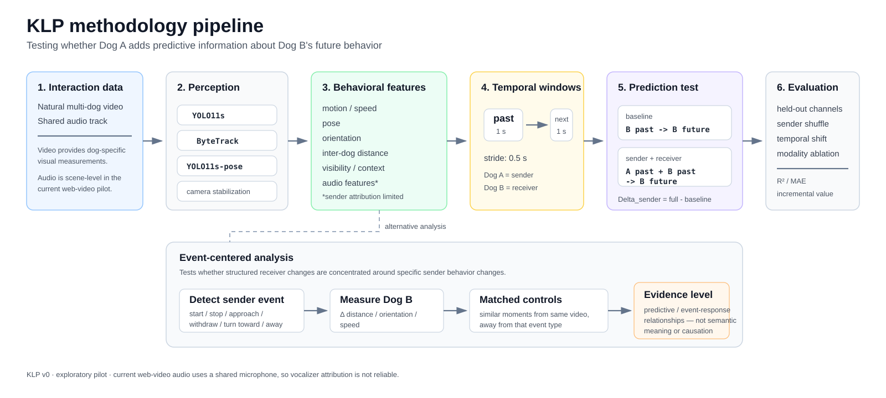

# KLP v0 — Kelb Language Processing

> Experimental research code for testing whether a sender dog's recent behavior improves prediction of a receiver dog's near-future behavior.

**Research status:** exploratory pilot. Current results do **not** establish causation, communication, semantic meaning, or intention.

<p align="center">
  
</p>

## Core question

KLP tests whether information from Dog A adds predictive value beyond Dog B's own recent behavior.

- **Receiver baseline:** `(B_past, dyadic state, context) -> B_future`
- **Sender + receiver:** `(A_past, B_past, dyadic state, context) -> B_future`
- **Sender increment:** `Delta_sender = performance(A + B) - performance(B)`

The prediction targets are deliberately low-level and non-anthropomorphic: future change in the receiver's **distance, orientation, and velocity**.

Dyadic state (for example pair distance) and scene context (for example visibility) remain in the baseline. The sender increment measures only information supplied by Dog A's sender features.

### Current modality note

Video provides dog-specific tracks and pose/motion measurements. Audio is also extracted, but the current web-video pilot usually has a **shared microphone**, so a vocalization cannot always be reliably attributed to Dog A or Dog B. Scene-level audio is therefore treated as attribution-limited rather than as a trusted sender-specific signal.

## Current pilot status

| Question | Current status |
|---|---|
| Does Dog A improve broad prediction of Dog B? | **No reliable sender advantage in the current clean pilot** |
| Are some sender events followed by structured receiver changes? | **Yes, exploratory event-specific associations** |
| Does this establish Dog A caused Dog B's response? | **No** |
| Does this establish communication or meaning? | **No** |
| Main bottleneck | **Better controlled, source-attributable multimodal data** |

The repository keeps negative and exploratory results visible because the aim is to test the hypothesis, not to force a positive interpretation.

## Repository map

| Path | Purpose |
|---|---|
| `src/klp/` | core data, feature, model, experiment, and evaluation code |
| `scripts/` | pilot extraction and experiment entry points |
| `configs/v0.yaml` | reproducible pilot configuration |
| `results/` | pilot reports, null tests, audio analysis, and event analyses |
| `tests/` | unit tests and toy fixtures |
| `docs/` | methodology figure and documentation assets |

## Included in v0

- Per-frame dog track format and a loader that turns tracks into sender-receiver interaction windows
- Candidate-video finder for the Pawgaze and K9-Bench question files
- Identity-disjoint train/test splits (by connected group of dogs, or by individual dog)
- Baseline and sender+baseline ridge models: linear by default; an optional variant with pairwise interaction terms can detect modalities that act only in combination (e.g. audio conditional on pose) but overfits at pilot data sizes
- Sender incremental-value experiment, overall and per target
- Leave-one-modality-out ablation over the sender modalities present in the data
- Repeated splits reporting mean ± std and how many rows the split drops
- CLI scripts and tests

## Data pipeline

Pawgaze and K9-Bench contain only YouTube IDs and multiple-choice questions, with no footage, tracks or dog identities. KLP features have to be extracted from the videos:

1. **Find candidate videos.** Download the question parquet(s) yourself (K9-Bench is CC BY-NC with its own terms of use; Pawgaze lists no license), then:
   ```bash
   python3.13 scripts/list_candidate_videos.py --pawgaze pawgaze.parquet --k9bench k9bench.parquet --out candidate_videos.csv
   ```
   This is a keyword heuristic over the questions; review the list manually, best tiers first. Each video gets a tier: `dog_dog_strong` / `dog_dog` (questions describe dogs interacting with each other), `multi_dog` (several dogs present), or `human_led` (several dogs, but the questions centre on people). Dogs on screens or in mirrors are ignored. On Pawgaze, 296 of 923 videos are flagged: 17 `dog_dog_strong`, 89 `dog_dog`, 117 `multi_dog`, 73 `human_led`.
   To keep only long, landscape, non-Short videos (heavily edited Shorts yield almost no usable windows), fetch YouTube metadata first; this downloads no video:
   ```bash
   .venv-pilot/bin/python scripts/pilot/fetch_metadata.py            # writes data/external/video_metadata.csv
   .venv-pilot/bin/python scripts/pilot/fetch_metadata.py --retry-blocked   # if YouTube's bot check blocked some
   python3.13 scripts/list_candidate_videos.py --pawgaze data/external/pawgaze_test.parquet \
       --metadata data/external/video_metadata.csv --min-duration 120   # writes candidate_videos_long.csv
   ```
   `scripts/pilot/search_videos.py --out data/external/search_candidates.csv --exclude <known lists>` finds more videos by YouTube search instead, using metadata only. It keeps results that are long enough, not Shorts, and whose titles mention dogs and don't suggest compilations, music or talks. Raw results are saved next to `--out`, and `--from-raw` re-filters them without searching again. Titles are a weak filter, so check the footage before tracking: `scripts/pilot/screen_videos.py --candidates <csv> --out data/external/screen/screen.csv` downloads each video at low resolution, counts dogs with YOLO on 20 frames spread through it, writes the share of frames with two or more dogs, and deletes the video. It can be resumed.
2. **Extract tracks (outside this repo).** For each video, run dog detection, tracking and pose estimation and write one row per dog per frame:

   | column | required | meaning |
   |---|---|---|
   | `video_id`, `track_id`, `time_s` | yes | recording, dog track within it, timestamp (regular frame rate) |
   | `x`, `y` | yes | position, in any unit consistent within a video (pixels are fine, but distances are then not comparable across videos) |
   | `heading` | yes | body orientation in radians |
   | `dog_id` | no | identity across videos; defaults to `<video_id>:<track_id>` |
   | `channel_id` | no | uploader/channel; videos from one channel often show the same dogs, so `split_unit: channel` keeps them together. Defaults to `video_id` |
   | `shot_id` | no | camera shot; windows never cross a cut. Defaults to one shot per video |
   | `source` | no | e.g. `pawgaze`, `k9bench` |
   | `visibility` | no | 0-1 detection confidence; defaults to 1.0 |
   | `body_size` | no | dog size in position units (e.g. √(box area) in pixels); length features are divided by it so they are in body sizes and comparable across videos. Defaults to 1.0 (no scaling) |
   | `pose_compactness`, `head_height` | no | pose modality |
   | `audio_energy`, `audio_pitch` | no | audio modality; must be attributed to the dog producing it |

   Missing optional measurements remove that sender modality from the experiments. Motion and orientation come from positions and headings, so they are always available.

   The pilot extractor `scripts/pilot/extract_tracks.py` (YOLO + ByteTrack) takes `--pose-model <Dog-Pose weights>` to add keypoints: heading from the body axis (falling back to motion direction, see `heading_source`), `head_heading`, `head_height`, `pose_compactness` and raw `kp_*` columns. `scripts/pilot/stabilize_tracks.py --tracks <tracks.parquet>` then removes camera motion (pans, zoom, rotation estimated from background optical flow) and writes `tracks_stabilized.parquet`; use that for experiments on handheld footage.

   `scripts/pilot/extract_audio.py --audio <folder of <video_id>.m4a>` (run with `.venv-pilot`) scores 1 s audio windows every 0.5 s with AST (AudioSet): dog vocal, bark, music and speech probabilities, loudness, and a 768-d embedding per window. These are scene-level, not attributed to a dog, so they do not fill `audio_energy`/`audio_pitch`. On the pilot YouTube videos the soundtracks are mostly music or narration, so audio is not used in the experiments (`results/pilot_audio_2026-10-31.md`).
3. **Run the experiments:**
   ```bash
   python3.13 scripts/run_experiments.py --tracks tracks.parquet   # uses configs/v0.yaml
   ```

### How windows are built

Every ordered pair of dogs in a shot yields windows at each anchor time (window lengths and stride in `configs/v0.yaml`), so each dog is both sender and receiver. Windows never span a shot boundary or a gap in either track. Receiver targets are measured against the sender's position at the anchor time, so the sender's own future movement does not leak into them. `delta_distance` is the receiver's displacement along the line away from that position (sideways movement does not count), the same projection as `receiver_distance_past`.

`run_experiments.py` then:

1. keeps windows with complete features for the available modalities;
2. keeps only pairs tracked together without a gap for at least `min_run_s` and at most `max_pair_distance` body sizes apart at the anchor time;
3. keeps at most `max_windows_per_video` randomly chosen windows per video, so long or many-dog videos cannot dominate;
4. runs the sender increment and leave-one-modality-out ablation over repeated splits, with the model set by `model` (`linear` ridge by default, or `interaction`);
5. compares the real sender increment with two nulls on the same splits and rows: sender features shuffled within each video (`shuffle`), and sender features circularly shifted within each pair by at least `null_min_shift_s` (`time_shift`). A sender effect only counts if it beats both; `p_value` is the share of null draws at least as good as the real data.

`scripts/run_lag_and_events.py --tracks <files...>` adds two analyses on the same filtered pipeline: a response-lag sweep (the receiver's target window starts `lags_s` after the sender's past window ends), and sender move onsets (a still sender starting to move, defined under `events` in the config). For onsets, a receiver-only baseline cross-fitted by channel is compared between onset windows and control times of the same pairs, with a 95% interval from resampling channels; onsets where the receiver started at the same time are excluded.

`scripts/run_communication_events.py --tracks <files...>` (cycle 5) detects six kinds of sender event per ordered pair (`klp.data.events`):
- move onset and stop;
- approach and withdraw (sender velocity toward or away from the receiver);
- turn toward and turn away (pose body heading only).

Each event kind is a change in one sender signal between the 0.5 s before and the 0.3 s after. For each kind and response lag (`communication_events` in the config):
- The receiver's change after each event is compared with its 5 nearest control moments in the same video. Controls are moments similar in the receiver's speed, orientation, distance change and pair distance, at least 3 s from any event of that kind in the pair (`klp.experiments.events`).
- Events where the receiver had the same kind of event just before are dropped, since a shared change points to a shared cause.
- p-values come from rerunning the same matching at random control moments of the same pairs (placebos), Holm-adjusted across all kinds, lags and targets.
- Intervals resample channels; with few channels they are too narrow, so rely on the placebo p.

Follow-ups:
- `scripts/check_event_robustness.py`: leave-one-channel-out and camera checks.
- `scripts/check_event_facing.py`: whether receivers facing the sender respond more.
- `scripts/run_event_regression.py`: adds the `events` sender modality, with one indicator per kind in the past window (`klp.data.events.add_event_features`). It is left empty (NaN) in `build_windows`, so the main experiments skip it unless it's filled.

## Quick start

Requires Python >= 3.10.

```bash
python3.13 -m pip install -e .
python3.13 -m pytest
```

There is no bundled dataset. The tests use a hand-written two-dog track file (`tests/fixtures/tracks_two_dogs.csv`) and small test-only toy tracks; they check the code, not any scientific result.

## Datasets, terms and citation

**K9-Bench** is used internally, for non-commercial research only, through approved access to the gated copy at [huggingface.co/datasets/ogmen/K9Bench](https://huggingface.co/datasets/ogmen/K9Bench). Its terms of use forbid sharing or redistributing the dataset in whole or in part, so keep the question file and anything listing its videos or questions (e.g. candidate lists) under `data/external/` or other local paths, and never commit or share them. Videos remain the property of their YouTube creators.

**Pawgaze** ([huggingface.co/datasets/pawgaze/pawgaze](https://huggingface.co/datasets/pawgaze/pawgaze)) lists no license on its dataset card.

Cite both in any publication:

```bibtex
@misc{attarde2026k9bench,
  title         = {K9-Bench: Evaluating Multimodal LLMs on Canine-Centric Videos},
  author        = {Attarde, Khush and Ali, Yusuf and Thukral, Megha and Bhutani, Divye and Ploetz, Thomas and Kira, Zsolt},
  year          = {2026},
  eprint        = {2607.02680},
  archivePrefix = {arXiv},
  note          = {NeurIPS 2026}
}

@inproceedings{pawgaze2025,
  title     = {Pawgaze: A Benchmark for Fine-Grained Multimodal Analysis of Canine Behavior},
  author    = {TODO: add authors from the NeurIPS 2025 proceedings},
  booktitle = {Advances in Neural Information Processing Systems (NeurIPS)},
  year      = {2025},
  url       = {https://neurips.cc/virtual/2025/131537}
}
```

## Scientific safeguards

- Never random-split clips when the same dog can appear in train and test.
- For web video, split by channel (`split_unit: channel`, the default): one channel often films the same dogs across many videos, and track fragments of one recording also stay together. Without `channel_id`, each video counts as its own channel, which equals `split_unit: video`. With clean per-video dog IDs, `split_unit: component` (connected groups of dogs) also drops no rows. If the same dogs meet across many videos, everything becomes one group; use `split_unit: dog`, which drops every row whose two dogs land on opposite sides (with `test_fraction` 0.25, only ~6% of rows reach test). Always report split stats and variance across splits.
- The same dog can appear in several web videos (e.g. from one channel). If you can identify this, give those tracks the same `dog_id`.
- Windows from one recording must not span train and test; the split raises if a `video_id` does.
- Keep raw/continuous behavior variables where possible.
- Treat attention/feature weights as hypotheses; validate with ablations.
- Context classification is not equivalent to communicative meaning.
- Predictive association is not causal evidence of receiver interpretation.
